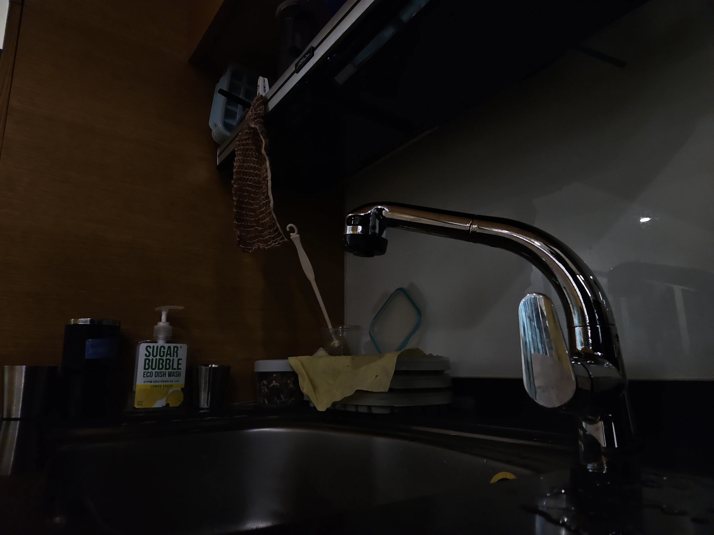
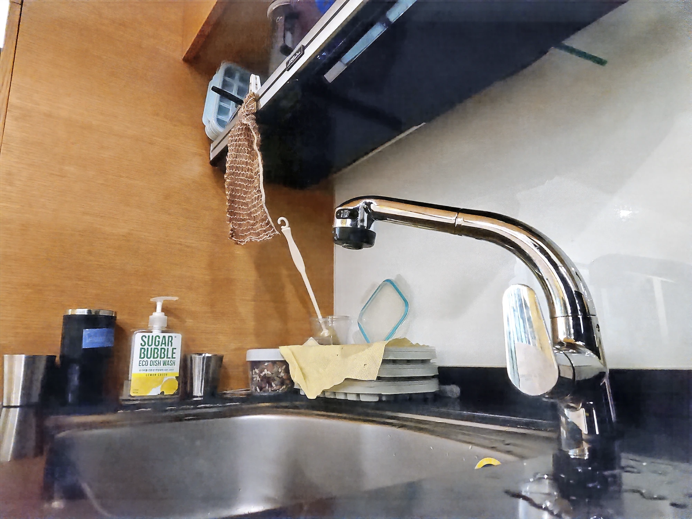
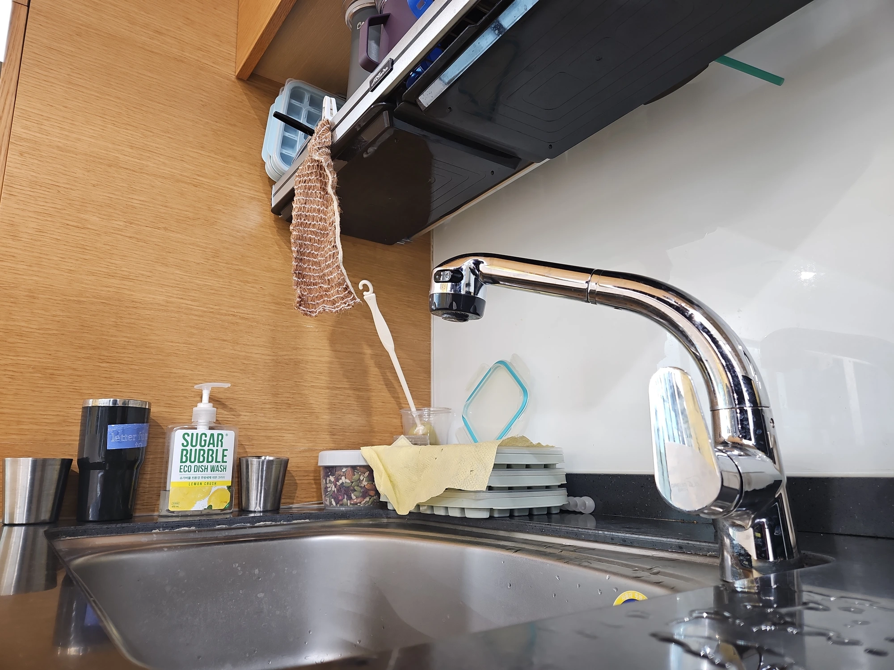

<h1 align="center">
  GLOW-FM<br>
  Efficient Generative Low-Light Image Enhancement with One-Step Latent Flow Matching
</h1>

<p align="center"><strong>WACV 2027 · Algorithm Track</strong></p>

<p align="center">
  Ariel Lapid<sup>*</sup>, Yuval Haitman<sup>*</sup>, Reuven Peretz, Arnon Netzer, Idit Diamant<br>
  Arm AI Research (AAIR), Arm Ltd<br>
  <sub>* Equal contribution</sub>
</p>

<p align="center">
  <a href="https://arxiv.org/abs/2610.31222v1">📄 Paper</a> ·
  <a href="https://arm-research.github.io/AAIR-GLOW-FM/">🌐 Project Page</a> ·
  <a href="#citation">📚 Citation</a>
</p>

## TL;DR

GLOW-FM combines a lightweight Tiny-VAE encoder with an
[Hourglass Diffusion Transformer (HDiT)](https://arxiv.org/abs/2401.11605)
architecture to perform efficient enhancement in a compact latent space.
Trained with [Terminal Velocity Matching (TVM)](https://arxiv.org/abs/2511.19797),
the HDiT restores low-light latents in a single step. Together, the compact
architecture and single-step inference enable efficient generative low-light
image enhancement.

| Low-light input | GLOW-FM | Ground truth |
|:---:|:---:|:---:|
|  |  |  |

<p align="center">
  Low-light input, GLOW-FM enhancement, and ground truth (GT) on LSD-DLL.
</p>

## Highlights

1. **Efficient generative enhancement.** Compact latent flow matching delivers
   one-step restoration at low computational cost.
2. **TVM for image restoration.** Adapted to low-light enhancement and validated
   against alternative one-step objectives in matched comparisons.
3. **Strong generalization.** State-of-the-art cross-dataset results among the
   compared methods, with competitive image quality.

> 🏆 GLOW-FM extends our [LFM-LLIE](https://arm-research.github.io/AAIR-LFM-LLIE/),
> which won <strong>1<sup>st</sup> place</strong> in the
> [NTIRE 2026 Low-Light Image Enhancement Challenge](https://arxiv.org/abs/2604.17669)
> at CVPR 2026.

## Method


A frozen Tiny-VAE maps images into a compact latent space. An HDiT parameterizes
a two-time displacement model trained with flow matching and Terminal Velocity
Matching. At inference, GLOW-FM encodes the input, restores its latent
representation in one network evaluation, and decodes the enhanced image.

## Quick Start

### 1. Install

GLOW-FM requires Python 3.11 or 3.12 with a CUDA-capable PyTorch environment.
Install with:

```bash
chmod +x setup.sh
./setup.sh
source .venv/bin/activate
```

Alternatively, install the same dependencies manually:

```bash
python3 -m venv .venv
source .venv/bin/activate
python -m pip install --upgrade pip wheel
python -m pip install --extra-index-url https://download.pytorch.org/whl/cu126 \
  torch==2.7.1+cu126 torchvision==0.22.1+cu126 torchaudio==2.7.1+cu126
python -m pip install --no-build-isolation -r requirements.txt
```

### 2. Organize the LSD-DLL Dataset

Download LSD-DLL from [sharif-apu/LSD-TFFormer](https://github.com/sharif-apu/LSD-TFFormer)
and arrange it as follows:

```text
<PATH_TO_DATA>/
├── DLL_train_full/
└── DLL_val/
    ├── low/
    └── gt/
```

Training metadata is loaded automatically from
`datasets/dll_train_metadata.json`.

### 3. Train

```bash
CUDA_VISIBLE_DEVICES=0,1,2,3,4,5,6,7 \
NCCL_NET=Socket \
python train.py \
  --config-name train_glowfm_dll \
  dataset.path=<PATH_TO_DATA>
```

The default configuration uses eight GPUs. Override Hydra settings such as
`pl.devices`, `pl.strategy`, or `dataloader.num_workers` when using a different
machine.

### 4. Run Inference

Enhance one image or every supported image in a directory:

```bash
python inference.py \
  --checkpoint <PATH_TO_CHECKPOINT> \
  --input <INPUT_IMAGE_OR_DIRECTORY> \
  --output <OUTPUT_DIRECTORY> \
  --device cuda
```

The checkpoint supplies the architecture configuration and model weights.
Inference uses one function evaluation by default.

### 5. Evaluate

Evaluate paired low-light and ground-truth images with PSNR, SSIM, and NIQE:

```bash
python evaluate.py \
  --checkpoint <PATH_TO_CHECKPOINT> \
  --input <LOW_LIGHT_IMAGE_OR_DIRECTORY> \
  --gt <GROUND_TRUTH_IMAGE_OR_DIRECTORY> \
  --output <OUTPUT_DIRECTORY> \
  --device cuda
```

The output directory contains enhanced images, per-image results in
`metrics.csv`, and aggregate results in `metrics.json`. Select different PyIQA
metrics with `--metrics`, for example `--metrics psnr,ssim,lpips-vgg,niqe`.

## License

Except where individual files state otherwise, this project is licensed under
the [Apache License 2.0](LICENSE). Files adapted from third-party projects remain
subject to the licenses identified in their source headers.

## Acknowledgements

This project builds upon and is inspired by:

- [lumalabs/tvm](https://github.com/lumalabs/tvm)
- [ohayonguy/PMRF](https://github.com/ohayonguy/PMRF)
- [crowsonkb/k-diffusion](https://github.com/crowsonkb/k-diffusion)
- [Dao-AILab/flash-attention](https://github.com/Dao-AILab/flash-attention)
- [Ryu1845/min-sCM](https://github.com/Ryu1845/min-sCM)

Please refer to the respective repositories and per-file source headers for
license details and usage terms.

## Citation

If you find this work useful, please consider citing our paper:

```bibtex
@misc{lapid2026glowfmefficientgenerativelowlight,
      title={GLOW-FM: Efficient Generative Low-Light Image Enhancement with One-Step Latent Flow Matching},
      author={Ariel Lapid and Yuval Haitman and Reuven Peretz and Arnon Netzer and Idit Diamant},
      year={2026},
      eprint={2610.31222},
      archivePrefix={arXiv},
      primaryClass={cs.CV},
      url={https://arxiv.org/abs/2610.31222},
}
```
